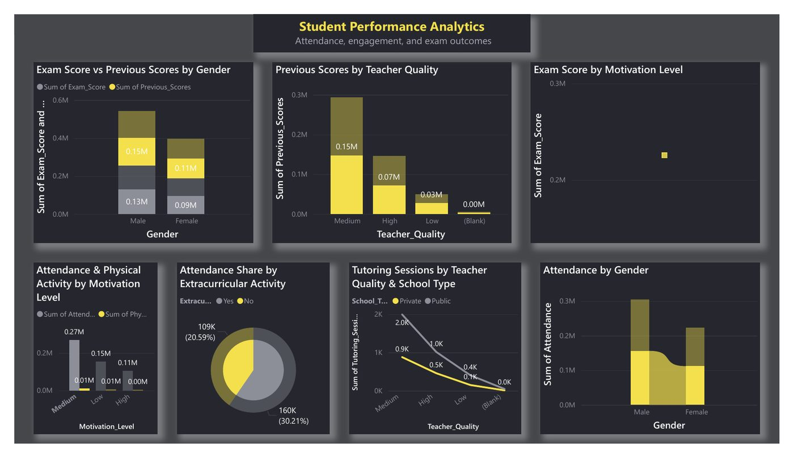

# Student Performance Analytics

**Tool:** Power BI

Attendance, engagement and exam outcomes compared across gender, teacher quality, motivation level and school type.

## Highlights
- Exam score against previous scores by gender and by teacher quality
- Attendance by motivation level, gender and extracurricular activity
- Tutoring sessions by teacher quality and school type

## Files
- `Student_Performance_Analytics.pbix`
- `Student_Performance_Analytics_1.pdf`

The PDF is an export of the dashboard page.

## How to open
Open the `.pbix` in Power BI Desktop (free, Windows).

---
By Faaz Mistry · [LinkedIn](https://www.linkedin.com/in/faaz-mistry-369a11246/) · faazmistry110@gmail.com
